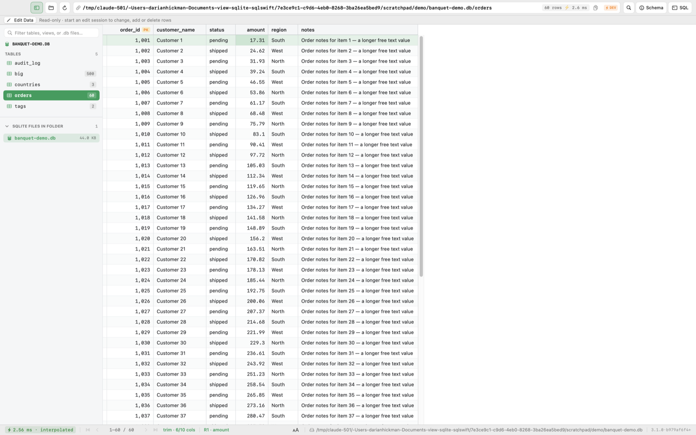
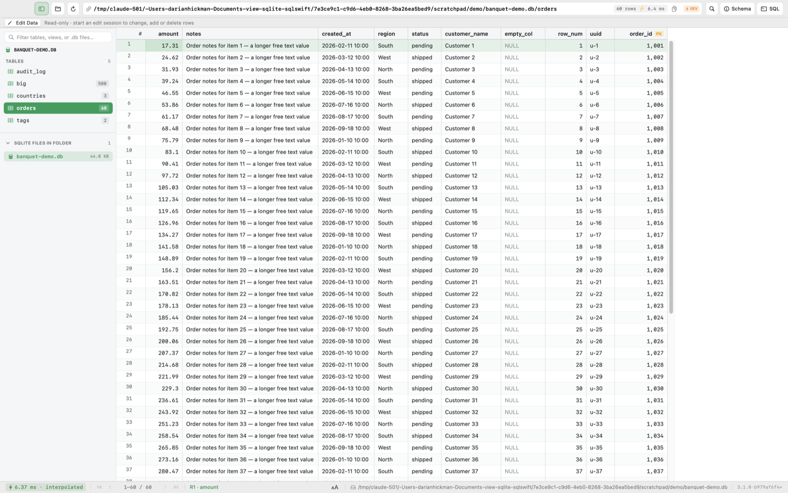
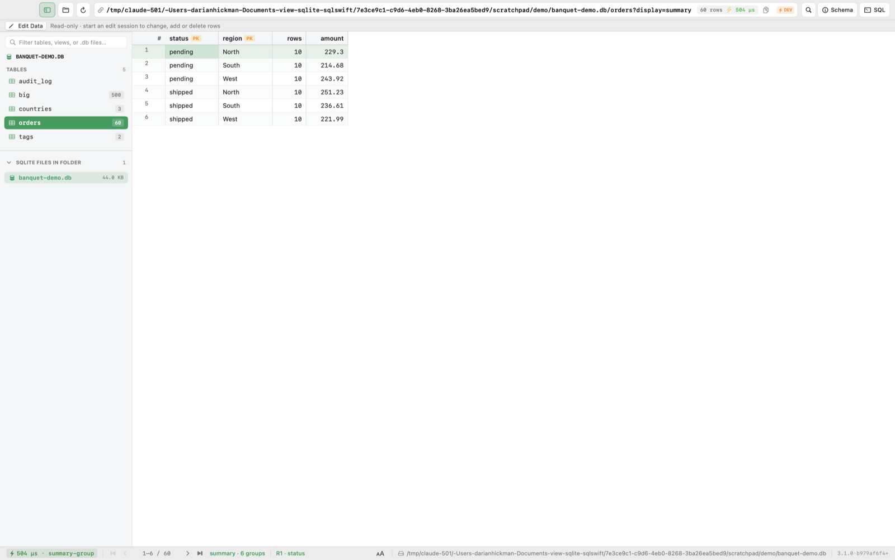

# Banquet Query Style

**Status: recommended (host / renderer convention).** Nicknamed **trim** in the
UI — the default display kind. Banquet Query Style decides *which* columns a
result shows and in *what order*. How the cells and rows are then drawn is a
separate concern — see [banquet-grid-style.md](banquet-grid-style.md).

The reference implementation is `sqlite.mavgo.com`'s `sql-engine.js`
(`orderColumns` / `visibleColumns` / `buildSummary` / `probeTable`). A one-time
table sample (2000 rows, skipped past 60 columns) supplies the non-null /
cardinality / duplicate signal the rules need.

Rules, most significant first:

0. Don't display empty / all-null columns.
1. Primary key first, in key order — even if it's physically last.
2. After the pk, prioritise columns whose name reads like `name` / `label` /
   `description`.
3. Don't display a row-number column — it's redundant with the primary key.
4. A column with fewer than 10 distinct values that is never null is a grouping
   column: `summary` groups by it, `trim` treats it as a per-group header.
5. Hide technical / system columns by default: `created_at`, `updated_at`,
   `deleted_at`, `version`, `tenant_id`, `uuid` (when a real pk exists), audit
   columns. A `_style` column hint that names one overrides this.
6. Order what's left: status / type / category, then date / time, then
   numeric / amount, then long free-text last.
7. Drop near-duplicate columns — `name` vs `display_name`, or `id` vs `code`
   that hold the same value in every sampled row. Keep the more useful one (the
   pk, else the shorter name).
8. No column cap for normal tables. Past ~40 surviving columns `trim` keeps the
   first ~40 in priority order; `raw` is always the uncapped
   show-everything view.
9. Don't display the `rowid` when the primary key already carries it. If a table's
   pk is an `INTEGER PRIMARY KEY` it *is* the rowid (an alias), so a separate
   `rowid` column — or any row-number column, see rule 3 — is a duplicate of it
   and is dropped. A table with no such pk (a rowid table with a composite or
   non-integer pk, or no pk) keeps the `rowid` as its identity column, since
   nothing else uniquely names the row. `raw` is unaffected and shows it.

A `_style` / `_head` row keyed `"<table>.columns"` (or bare `"columns"` for a
one-table db) is an authoritative column-order prefix — it steers `trim` and
`summary`, never `raw`, and a column it names is never dropped by rules 0/3/5/7/9.

## sqlswift reference screenshots

*Captured from the sqlswift dev app (`scripts/gui-access.sh`, `snapshot` UI command). The bar shows the canonical URL for each view.*

Demo table `orders` has 10 columns: pk `order_id` last, an all-null `empty_col`, a `row_num`, `created_at`, `uuid`.

**`trim` (default)** — 6 of 10 columns: pk first, name-like next, then status/category, amount, free text last; null, row-number and technical columns dropped (rules 0, 1, 2, 3, 5, 6, 9):

**`raw`** — the uncapped view with every column, in table order (rule 8):

**`summary`** — groups by the low-cardinality columns `region` and `status` (rule 4):

