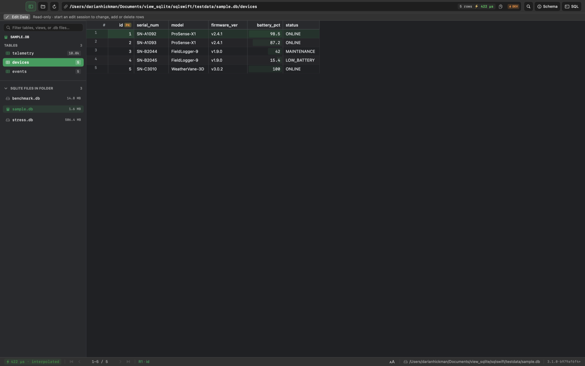
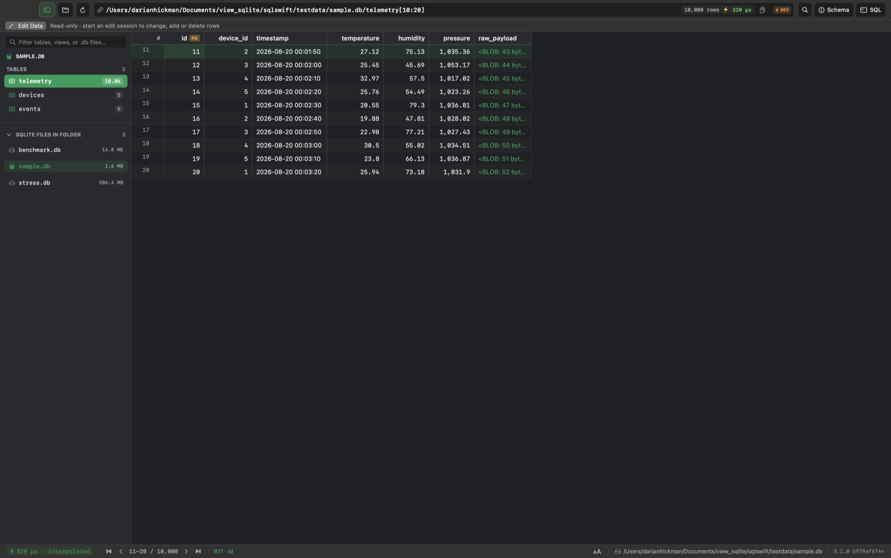
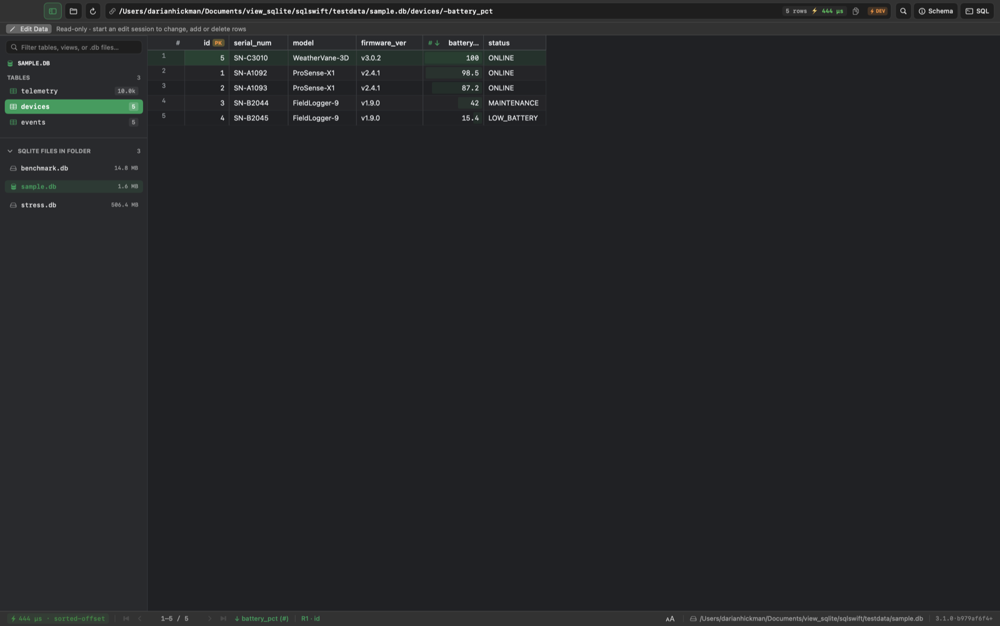
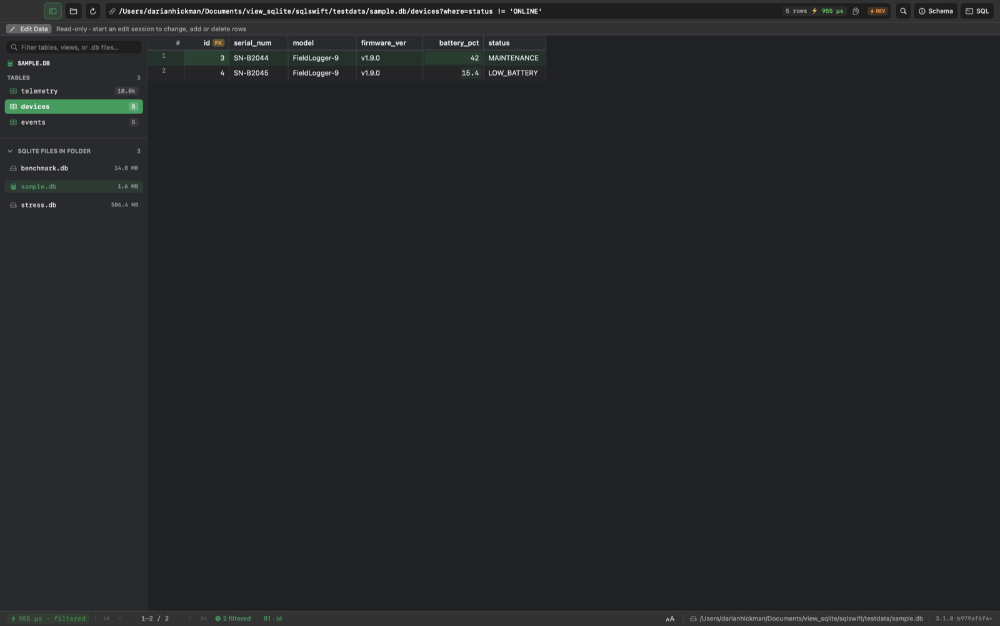
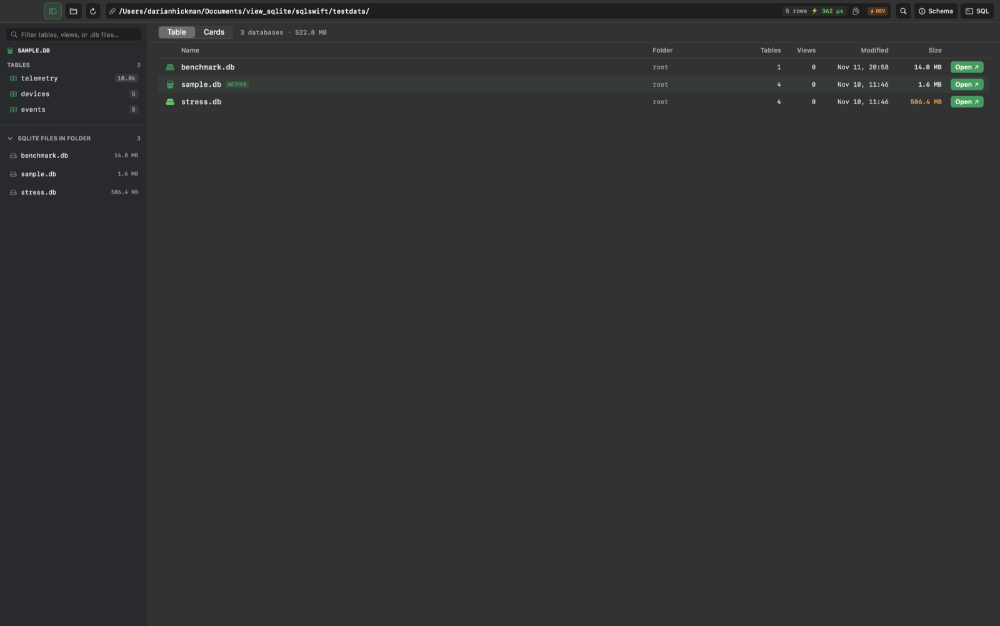

# Banquet URL Syntax

Banquet supports a flexible syntax that ranges from explicit to inferred, designed to be both machine-precise and human-readable.

### 1. Explicit Banquet Notation
For unambiguous parsing, Banquet uses semicolon (`;`) delimiters to strictly separate the setup components.
*   **Format**: `path/to/dataset;Table;Column`
*   **Example**: `data/sales.sqlite;orders;amount`
*   This explicitly tells the parser: "Dataset is `data/sales.sqlite`, Table is `orders`, Component is `amount`".

### 2. Familiar Syntax
For ease of use, Banquet supports a standard slash-delimited syntax that mimics file system paths or standard REST URLs.
*   **Format**: `path/to/dataset/table/column`
*   **Example**: `data/sales.csv/amount`
*   Banquet uses heuristics (checking for file extensions like `.csv`, `.sqlite`, `.db`) to guess where the dataset path ends and the query begins.

### 3. Inferred Defaults
Banquet strives to "do what you mean":
*   **Select All**: If the URL points to a table but specifies no columns (or effectively selects the table name itself), Banquet infers `SELECT *`.
*   **Table Guessing**: In simple one-table formats (like CSV), functionality allows omitting the table name, treating the file as the table.

### 4. Syntax Sugar for Slice Notation
Banquet supports Python-like slice notation in the path to handle pagination (`LIMIT` and `OFFSET`).
*   **Syntax**: `[start:end]`
*   **Behavior**:
    *   `start` becomes `OFFSET`.
    *   `end - start` becomes `LIMIT`.
*   **Example**: `/data/users[10:20]`
    *   Parses to: `OFFSET 10`, `LIMIT 10`.

### 5. Sort
Sort order can be defined directly in the path using prefix modifiers on column names.
*   **Ascending**: `+` prefix. Example: `/data/users/+lastname` (Sort by lastname ASC).
*   **Descending**: `-` prefix. Example: `/data/users/-age` (Sort by age DESC).
*   *Note: This can also be handled via the `orderby` query parameter.*

### 6. Equality & Filtering
Simple equality checks can be embedded directly in the path segments alongside columns.
*   **Syntax**: `Column!=Value`
*   **Example**: `/data/users/status!=active`
*   **Behavior**: This is parsed into the `WHERE` clause.
*   Complex filters are supported via the standard `where` query parameter (e.g., `?where=age>21`).

#### The query string defaults to `WHERE`
Everything after the `?` is a filter unless its key is reserved. A parameter whose key is **not** one of the reserved keys below is a `WHERE` condition, so the `where=` prefix is optional:

| URL | Effective `WHERE` |
|---|---|
| `/data/users?age>21` | `age>21` |
| `/data/users?status=active` | `status = 'active'` |
| `/data/users?status!=active&age>21` | `status != 'active' AND age>21` |
| `/data/users?where=age>21&status=active` | `age>21 AND status = 'active'` |

*   **Reserved keys** (never conditions): `where`, `filter`, `limit`, `offset`, `sort`, `orderby`, `order`, `groupby`, `having`.
*   **Combining**: conditions from `where=`, bare parameters, and path equality (`col!=value`, section 6) are joined with `AND`.
*   **Value quoting**: `col=value` and `col!=value` are quoted like path equality (numbers stay bare, text is single-quoted). Any other form (`age>21`, `name LIKE 'A%'`) is passed through as written.
*   **Needs an operator**: a parameter is a condition only if it contains a comparison (`=`, `!=`, `<`, `>`, `<=`, `>=`, or `LIKE` / `IN` / `IS` / `BETWEEN`). A bare token such as `?markov` is not a condition; it stays an opaque parameter (collection catalogs use it as a search term, section 7).
*   **Implementations** that ignored unrecognized parameters before this rule were silently dropping the user's filter; a viewer should surface a condition it cannot apply rather than echo it back as if it had worked.

### 7. Folders and Datastores (Collections)
A path whose dataset portion carries **no recognized file extension** names a *container* rather than a single dataset. `ParseBanquet` sets `IsCollection` on the result and leaves the container path in `DataSetPath`; the host responds with a synthetic **catalog** of the datasets reachable under the container — recursively, so a folder lists the databases in it and its subfolders.

The container path runs up to the first **reserved catalog table** (`databases`, `tables`) or clause-like segment; everything after is the ordinary table + sort + slice + filter grammar, applied to the catalog. `/` is the root container — every reachable dataset.

*   **Example**: `/home/Documents` → catalog of every database under `Documents/`.
*   **Example**: `/home/Documents/databases/-size_bytes` → that catalog, sorted by size descending.

Full specification: [`docs/collections.md`](docs/collections.md).

## sqlswift reference screenshots

*Captured from the sqlswift dev app (`scripts/gui-access.sh`, `snapshot` UI command). The bar shows the canonical URL for each view.*

**Explicit notation** — `sample.db;devices` opens table `devices` (§1):

**Familiar syntax** — `sample.db/devices` (§2):

**Slice** — `telemetry[10:20]` shows rows 11–20 of 10,000 (§4):

**Sort** — `devices/-battery_pct` descending (§5):

**Equality filter** — `devices/status!=ONLINE`; the bar canonicalises it to a `where` (§6):

**Bare query condition** — `devices?battery_pct<50` is a `WHERE` with no `where=` (§6):

**Collection** — a path with no dataset extension (`testdata/`) opens the catalog (§7):

